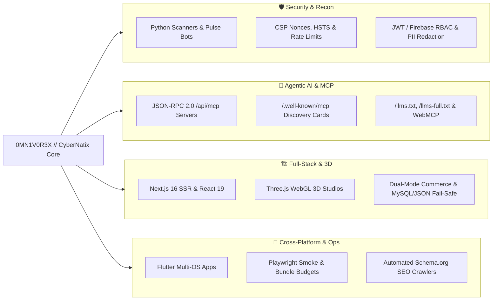

<div align="center">

<!-- Animated Cyber Command Header -->
<a href="https://github.com/0MN1V0R3X">
  
</a>

<br />

[](https://github.com/0MN1V0R3X)
[](https://github.com/0MN1V0R3X/Ak43EndER)
[](https://github.com/0MN1V0R3X)
[](https://modelcontextprotocol.io/)
[](https://github.com/0MN1V0R3X)

</div>

---

## 🧬 Operator Dossier (`whoami`)

```yaml
operator:      "0MN1V0R3X // Ak43EndER"
codename:      "CyberNatix"
classification: "Full-Stack Systems Architect · AppSec & Network Engineer · Agentic AI Builder"
execution:     "End-to-End — From raw packets & hardened APIs to 3D WebGL & cross-platform apps"
focus_vectors:
  - "Offensive/Defensive Security, Zero-Trust Gateways & Automated Recon Tooling"
  - "Model Context Protocol (MCP) Servers, /llms.txt Discovery & Autonomous Agent Interfaces"
  - "High-Craft Luxury-Tech Storefronts, 3D Spatial Web & Dual-Mode Commerce Engines"
  - "Cross-Platform Mobile/Desktop Engineering (Flutter) & Automated Release Pipelines"
```

> **Philosophy:** Build systems that look effortless on the surface, stay impenetrable at the boundary, and speak fluently to both humans and autonomous AI agents.

---

## ⚡ Core Superpowers & Hands-On Capabilities

### 1. 🛡️ Cybersecurity, AppSec & Network Recon
- **Custom Network & Recon Tooling**: Built Python-based network scanners, multi-threaded port scanners, pulse monitors, and AP automation scripts (`scanner.py`, `port_scanner.py`, `pulse.py`, `ap_bot.py`).
- **Zero-Trust Web Hardening**: Strict Content Security Policy (CSP) with nonces, HSTS, CORS origin allowlists, dotfile/backup path shielding (`.env`, `.git`, `.sql`, `.bak`), and trusted-proxy IP validation.
- **Auth & Data-Boundary Engineering**: JWT/HTTP-only cookie auth, Firebase ID token verification, Firestore security rule test suites, PII-redacting structured JSON loggers, CSV formula-injection neutralization, and UUID-sanitized upload pipelines.

### 2. 🤖 Agentic AI & Model Context Protocol (MCP) Engineering
- **MCP-Native Infrastructure**: Designed and shipped production **Model Context Protocol** JSON-RPC 2.0 servers (`/api/mcp`) and auto-discovery cards (`/.well-known/mcp/server-card.json`) exposing live catalog search, pricing estimators, and structured resources.
- **Machine-Readable Web (`llms.txt` & `WebMCP`)**: Built `/llms.txt`, dynamic `/llms-full.txt` catalog routes, `rel="describedby"` discovery links, and browser-native `WebMCP` tool hooks.
- **Local & Domain AI Systems**: Hands-on deployment of local LLM runtimes (**Ollama**) alongside domain-tuned API advisors (`/api/ai/advisor`).

### 3. 🏗️ Full-Stack Enterprise Web & Commerce Architecture
- **Modern Web Core**: Production mastery of **React 19**, **Next.js 16 (App Router + Standalone SSR)**, **TypeScript**, **Node.js (ESM)**, **Express**, **Vite 8**, and **Tailwind CSS v4**.
- **Dual-Mode Commerce & Fail-Safe Data**: Architected toggleable `showroom` vs. `direct` commerce engines (**Razorpay** orders/webhooks, **Supabase**, **Resend**, **MSG91 OTP**) and MySQL + **Strapi v5** headless CMS pipelines with automatic local JSON fail-safe stores.

### 4. 🧊 3D Spatial Web, Motion & Luxury-Tech Design
- **Interactive 3D Studios**: Engineered real-time **Three.js / WebGL** 3D product studios with lighting, material finish selectors, and pinch-zoom gallery stages.
- **Visual & Motion Craft**: Choreographed high-conversion interfaces with **Framer Motion / Motion**, **NVIDIA Omniverse**, and **DaVinci Resolve** media pipelines.

### 5. 📱 Cross-Platform Native & Web3 Engineering
- **Multi-Target Flutter Apps**: Built **Flutter / Dart** applications targeting Android, iOS, Windows, Linux, macOS, and Web from unified codebases.
- **Web3 Readiness**: Integrated **Wagmi v3**, **Viem v2**, and **TanStack React Query** for wallet and verifiable credential workflows.

### 6. 🚀 DevOps, Performance Budgets & Technical SEO Automation
- **Automated Release Gates**: Built Node/PowerShell preflight checkers, **Playwright** browser smoke suites, entry-bundle size budget enforcers, Brotli/Gzip asset pre-compressors, and **Sharp** WebP image pipelines.
- **Enterprise SEO & SSR Injection**: Dynamic OpenGraph, Twitter Cards, Schema.org JSON-LD injection, XML sitemap generators, and custom HTTP/schema SEO audit crawlers.

---

## 🛠️ Full Arsenal & Technology Matrix

### 💻 Languages & Core Runtimes


### 🎨 Frontend, 3D WebGL & Cross-Platform


### ⚙️ Backend, Cloud, Data & Security


### 🤖 AI, Agent Protocols & Web3


---

## 🗺️ Execution & Systems Architecture




---

## 🏆 Featured Production Systems

| System | Domain & Role | Core Stack | Key Engineering Feats |
| :--- | :--- | :--- | :--- |
| **[SRAFS Platform](https://github.com/0MN1V0R3X/sra)** | Enterprise Architectural Fabrication & BOQ Platform | React 19, TypeScript, Express, MySQL + JSON, Sharp, MCP | Dynamic INR fabrication cost engine, BOQ blueprint pipeline, JSON-RPC 2.0 MCP server, `WebMCP`, and SSR JSON-LD injection |
| **[THE MANDIR STUDIO](https://github.com/0MN1V0R3X/THE-MANDIR-STUDIO)** | Bespoke Corian® Atelier & Interactive 3D Studio | React 19, Vite 8, Three.js, Firebase, Strapi v5, Express | Real-time WebGL 3D studio, Vastu compass, fused Firebase/Strapi CMS, AI advisor (`/api/ai/advisor`), and automated SEO auditor |
| **[SULoTA](https://github.com/0MN1V0R3X/sulota.com)** | Luxury Architectural Showroom & Dual-Mode Storefront | Next.js 16.4, React 19, Razorpay, Supabase, Playwright, MCP | Zero-trust `showroom` vs. `direct` commerce switch, dynamic `/llms-full.txt` catalog, standalone Node bundle, and mobile perf gates |
| **[LearnOrbit](https://github.com/0MN1V0R3X/LearnOrbit)** | Higher-Education Counselling & Admissions Platform | React 19, TypeScript 6, Vite 8, Tailwind v4, Motion, Wagmi | High-conversion admissions funnel, partner university showcase, and Web3/Query-ready frontend architecture |
| **NetworkTools & Flutter Suite** | Security Recon & Cross-Platform Utilities | Python, Sockets/Async, Flutter, Dart | Custom port/network scanners, pulse bots, and multi-target Flutter apps (`scrapeware`, `ReBooT`) |

---

## 📊 Live GitHub Telemetry

<div align="center">


</div>

---

<div align="center">

### ⚡ `0MN1V0R3X` · `Ak43EndER` · `CyberNatix`
**Architecting hardened systems, autonomous agent interfaces, and high-craft digital realities.**

</div>
